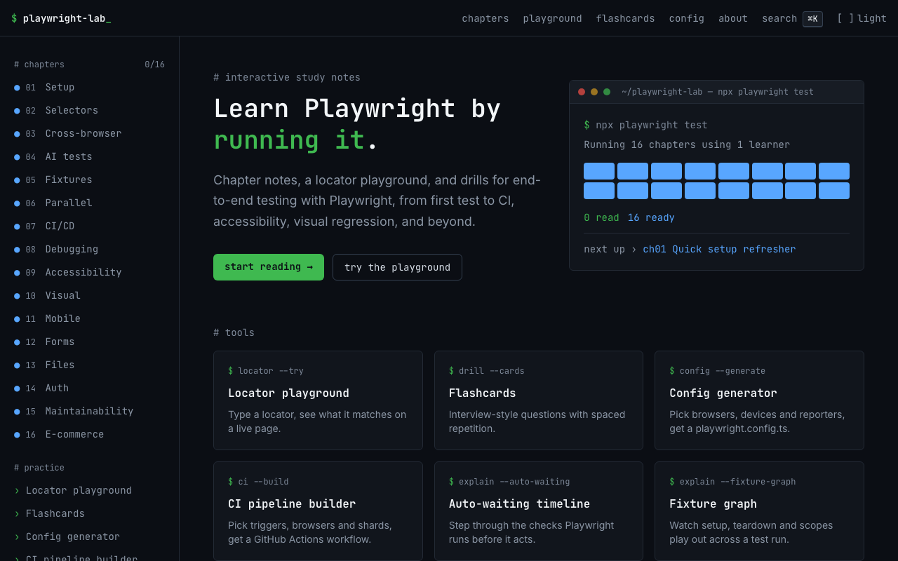
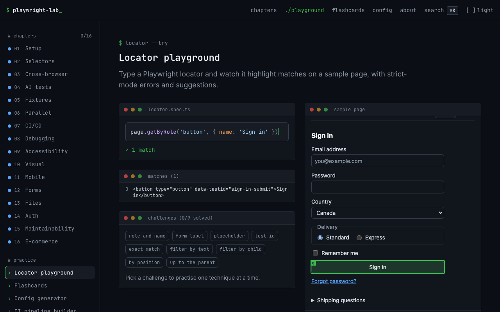
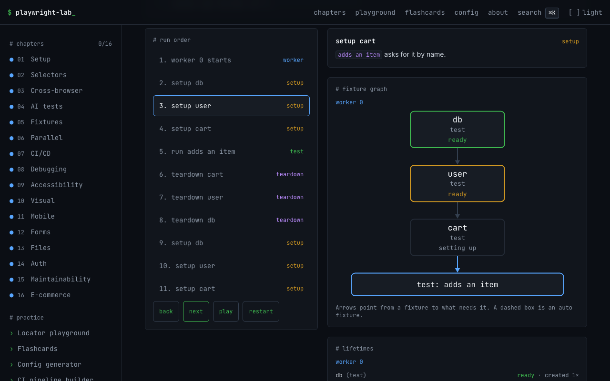
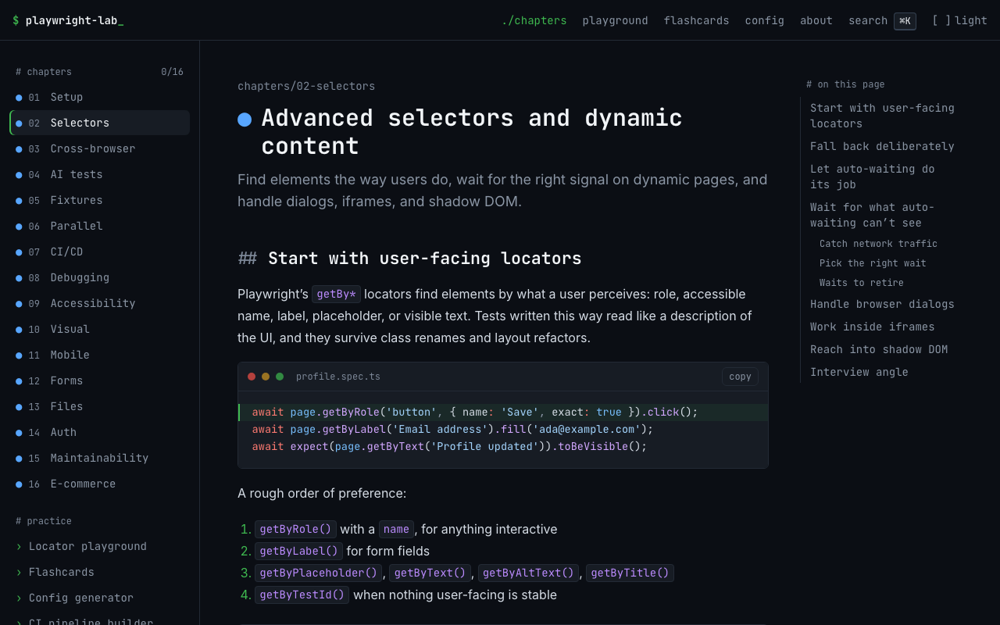
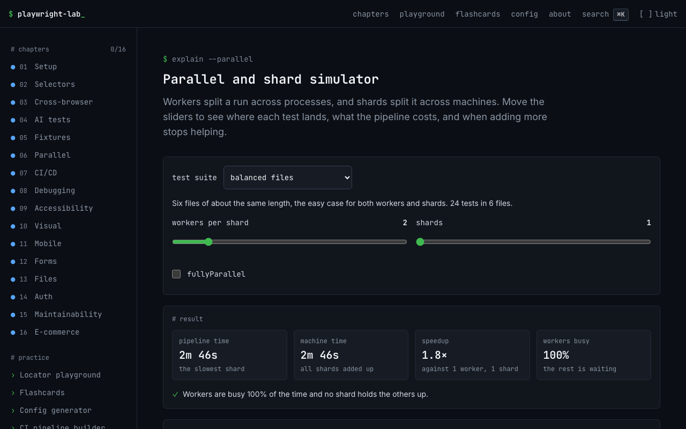
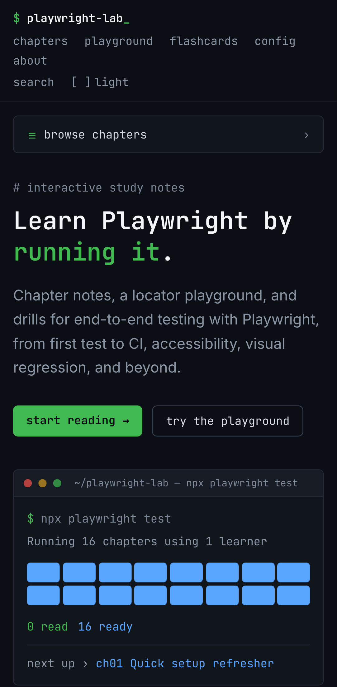
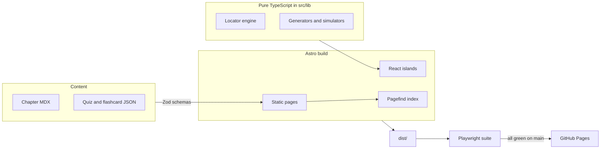

# playwright-lab

Interactive study notes, a locator playground, and drills for end-to-end testing with
[Playwright](https://playwright.dev). It's a static site, and it's tested with Playwright itself.

**Live site: [sourabhkejriwal.github.io/playwright-lab](https://sourabhkejriwal.github.io/playwright-lab/)**

[](https://github.com/sourabhkejriwal/playwright-lab/actions/workflows/deploy.yml)
[](https://sourabhkejriwal.github.io/playwright-lab/)
[](https://playwright.dev)
[](https://astro.build)
[](tsconfig.json)
[](tests/a11y.spec.ts)



## Features

- **16 chapters of notes**, from setup and selectors to CI, accessibility, visual regression, and a real-world
  e-commerce suite. Each one has a quiz and a flashcard deck.
- **Locator playground:** type a locator and see what it matches on a sample page, with strict-mode errors,
  suggestions, and preset challenges.
- **Flashcards:** interview-style questions with spaced repetition.
- **Generators:** build a `playwright.config.ts` or a GitHub Actions workflow from a few choices.
- **Explainers:** step through auto-waiting checks and fixture setup order, or simulate workers and shards.
- **Spot the flaky test:** find the line that makes a test unreliable, and say why.
- **Search, themes, and saved progress:** Pagefind search on <kbd>⌘K</kbd>, dark and light themes, and progress
  kept in the browser. There are no accounts and no backend.

## Screenshots

| Locator playground                                                                               | Fixture graph                                                                              |
| ------------------------------------------------------------------------------------------------ | ------------------------------------------------------------------------------------------ |
|  |  |

| Chapter notes                                                                          | Parallel and shard simulator                                                                 |
| -------------------------------------------------------------------------------------- | -------------------------------------------------------------------------------------------- |
|  |  |

<p align="center">
  
</p>

## Architecture

The site is plain HTML at build time. JavaScript loads only for the parts a visitor can interact with, as React
islands.



| Decision                                      | Why                                                                                                |
| --------------------------------------------- | -------------------------------------------------------------------------------------------------- |
| Astro static output with React islands        | The content is static, so most pages ship no framework code.                                       |
| Logic in pure modules under `src/lib/`        | Generators and simulators can be tested directly against real Playwright, without a browser UI.    |
| A hand-written locator parser and engine      | A static site can't run Playwright, and visitor input should never be executed.                    |
| Zod-validated content collections             | A malformed quiz or flashcard deck fails the build instead of reaching a visitor.                  |
| Progress in `localStorage` through nanostores | Visitors keep their progress with no backend, and saved data stays on their device.                |
| Design tokens in one file                     | Both themes come from `src/styles/tokens.css`, and contrast is checked by the accessibility tests. |

```text
src/
  content/     chapter notes, quizzes, and flashcards
  pages/       routes
  components/  static Astro UI
  islands/     interactive React components
  lib/         pure logic: locator engine, generators, simulators, spaced repetition
  stores/      saved visitor progress
tests/
  pages/       page objects, handed to tests as fixtures
  support/     test data and the app behind the flaky challenges
  *.spec.ts    the suite
```

## Test strategy

The suite has 380 tests, and each is listed on four Playwright projects: desktop Chrome, a Pixel 7, desktop
Firefox, and desktop Safari (WebKit). Tests that don't involve a browser run once. Everything runs against the
production build, so what gets tested is what gets deployed.

| Layer                                | What it proves                                                                                                                        | Where                                                                                                                   |
| ------------------------------------ | ------------------------------------------------------------------------------------------------------------------------------------- | ----------------------------------------------------------------------------------------------------------------------- |
| **Real Playwright as the reference** | The site's teaching material matches what Playwright really does. Generated configs, workflows, and listings are run on the real CLI. | `locator-engine`, `config-generator`, `ci-builder`, `auto-waiting`, `fixture-graph`, `parallel-sim`, `flaky-challenges` |
| **User journeys**                    | Visitors can read, drill, search, switch themes, and keep their progress.                                                             | `smoke`, `playground`, `playground-highlights`, `quiz`, `flashcards`, `search`, `progress`, `chapter-progress`, `theme` |
| **Accessibility**                    | axe finds no WCAG 2.0, 2.1, or 2.2 A and AA violations on any page, in either theme.                                                  | `a11y`                                                                                                                  |
| **Content and metadata**             | Study data is well formed, chapter components render, and pages carry correct SEO tags.                                               | `study-data`, `mdx-components`, `seo`                                                                                   |

The clearest example is the locator playground. Its engine is a reimplementation, so `locator-engine.spec.ts`
replays each expression on real Playwright and requires the same elements in the same order. If the two ever
disagree, the test fails.

Conventions the suite follows:

- **Page objects as fixtures.** Specs get page objects from `tests/pages/fixtures.ts`. Page objects return locators,
  and the assertions stay in the spec.
- **User-facing locators and web-first assertions.** Tests find elements by role, label, and text, and never use
  `waitForTimeout`.
- **Every browser in CI.** Each browser runs as its own job with `fail-fast: false`, so one failure doesn't hide
  another. Pull requests run the same checks, and `main` deploys only when all of them pass.

Known gaps: visual regression snapshots aren't in place yet, because they need Linux baselines. The three clipboard
tests run only on Chromium, because Firefox and WebKit can't be granted clipboard permissions.

## Run it locally

You need Node 24 and pnpm.

```bash
pnpm install
pnpm exec playwright install chromium firefox webkit

pnpm dev      # dev server on http://localhost:4321
pnpm test     # build, then run the full suite
pnpm test:ui  # Playwright UI mode
pnpm check    # type-check
pnpm format   # format with Prettier
```

Run a single project with `pnpm test --project=desktop`. After a design change, `pnpm screenshots` recaptures the
images in this README.
